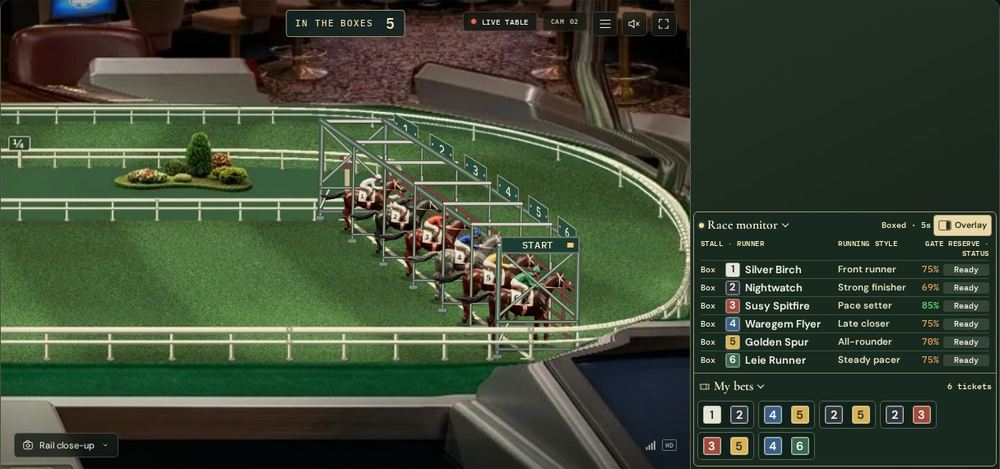

# Royal Ascot · Avond in het salon

Open `royal-ascot.html`. Kies **Watch table → Satellite floor** om de héle baan te zien. Achter de baan staan leren banken, lage tafels en een bar in gedempt licht. Het bord op het middenveld toont eerst de aftelklok en tijdens de koers de ronde, koploper en koerstijd. **Rail panorama** volgt de baan door beide bochten en houdt alle zes de paarden in beeld; een gekozen ticketrunner blijft in de groep, zonder dat het beeld inzoomt. **Action cam** kiest zelf een bewegend standpunt voor een duel of sprint. De nummers bewegen met de zadeldekken mee. Zodra de koploper uit de laatste bocht komt, schakelt elke camera naar de vaste positie bij de finish. Je kijkt het rechte stuk af; pas na het zesde paard komt je gekozen camera terug. **Track map** toont de zes rijlijnen op schaal. In **Cabinet orbit** kun je de bredere kast van boven bekijken.

| Maat van het model | Turf | Broad Turf |
|---|---:|---:|
| Tussen de rails | 59,64 cm | **85,20 cm** |
| Per baan | 9,94 cm | **14,20 cm** |
| Elk recht stuk | 3,40 m | **3,40 m** |
| Ronde over de middenlijn | 9,9403 m | **10,4128 m** |

Niet de camera, maar de **renbaan zelf** is 42,86% breder. De finish ligt nog steeds aan het einde van het rechte stuk. De maaibanen draaien mee in de bochten. Langs de rand liggen kortgeschoren stroken; tussen de grasvezels zitten verspreide, gepaarde hoefafdrukken. Beide omheiningen hebben 80 staanders, twee liggers en verbindingen. De kwart-, halve- en driekwartborden staan binnen de binnenrail. Bij dicht op elkaar lopende paarden verplaatst het kaartscherm alleen de nummerlabels, niet hun werkelijke posities.

**Geluid.** Zet het geluid vóór **Start race** aan. De aangeleverde fanfare begint wanneer de inzet sluit. Bij het openen van de hekken stopt een nog lopende fanfare en hoor je de aparte metaalopname. Beide bestanden zitten lokaal in het spel. De originele M4A en MP3 zijn bewaard; voor een browser zonder AAC zit er ook een FLAC van dezelfde fanfare bij. Onder **How to play → Sound** kun je per opname een eigen bestand kiezen of de standaard terugzetten.

**Inzetconsole.** De statcijfers op de console zijn één pixel groter. **Win** staat bij elke opening geselecteerd, ook na Show of Quinella. Op **Field** staan alle zes paarden met hun loopstijl, geschatte winstkans en quotering. De winstkans is de kans om **eerste** te worden volgens het koersmodel, niet de uitbetaling of het historische winstpercentage. Een paard kiezen werkt rechtstreeks in het veld, ook bij een paar. De knoppen voor **5, 10, 20, 50, 100 en 200 medailles** staan boven de paarden. Rechts staan alleen de daadwerkelijk geplaatste tickets, met inzet en vaste quotering; × annuleert en betaalt terug zolang de kassa open is. Op klein glas gebruik je hiervoor **My bets → Cancel**. **My bets** opent het volledige ticketboek.

**Livepaneel.** Zodra de zes paarden in de boxen stilstaan (−5 s), verschijnt rechtsonder één paneel met een 70% dekkende achtergrond. Het is circa een vijfde smaller én lager dan in de vorige editie. Druk op **Dock** om het naast het baanbeeld vast te zetten; op een smalle telefoon komt het eronder. Alle zes tickets blijven open. Met **Overlay** zet je het terug. Rechts toont **Race monitor** per paard de loopstijl en startreserve; na de start staat die stijl naast de werkelijke positie, resterende stamina en sprintstatus. Links toont **My bets** het speltype, de gekleurde startnummers, inzet, vaste quotering, nettowinst bij een treffer en de geschatte trefkans van het volledige ticket. Alleen die kans beweegt mee met de koers. Een Quinella heeft twee nummers in één kader. Tik tijdens de koers op een nummer om dat paard te volgen. **Saving** is groen, **Sprint** geel met donkere letters, **Spent** rood: bij Spent zijn de geplande sprints voorbij. De kleur van de reserve staat daar los van. De kassa en de afrekening behouden de ticketgegevens.

**STA op de koersklok.** In de Race monitor betekent STA hoeveel stamina een paard op dit moment over heeft. Op nieuwe startlijsten is de werkelijke sprintsnelheid bij gelijke waarden **25% lager** dan voorheen: bij een bruikbare SPR van 80 gaat de nominale factor van 2× naar 1,5×. Sprintcijfer en reserve bepalen de precieze versnelling. Bij sprinten kost elke koersseconde 3 procentpunt stamina. Bij sparen is dat **0,025 procentpunt per seconde**, ook na de laatste sprint. Wie met 90% begint en tien seconden spaart, houdt 89,75% over. De reserve kan niet onder 0% zakken. Tijdens een pauze en na de eigen finish verbruikt een paard niets. De monitor toont **groen vanaf 80%**, **rood tot en met 20%** en **oranje daartussen**. De regel geldt vanaf de eerstvolgende nieuwe startlijst.

**Sprintmoment.** Een *Strong finisher* versnelt vanaf het begin van ronde vier tot de streep. De *Late closer* sprint van halverwege ronde drie tot het einde van die ronde. Daarna spaart hij tot halverwege ronde vier en sprint van daar tot de finish. Een eerder uitgegeven startlijst behoudt zijn eigen schema.

**Vaste vaardigheid, nieuwe conditie.** Elk van de 50 paarden houdt dezelfde verdeling van 165 punten tussen sprintsnelheid en pace (kruissnelheid), ook onder een ander nummer. Op de openingskaart heeft Waregem Flyer 100 sprint en Susy Spitfire 100 pace. Fitness (FIT) en startstamina (STA) worden bij elke nieuwe start apart geloot van **80 tot en met 100%**. Beide kunnen dus tegelijk hoog zijn. STA is de stamina bij vertrek. Meer FIT helpt een paard later in de koers zijn kruissnelheid vast te houden. Ook de sprint vertrekt van die snelheid: FIT kan het paard dus werkelijk sneller laten sprinten, zonder het vaste sprintcijfer of de sprintfactor te verhogen. De resterende stamina bepaalt hoeveel van pace en sprint beschikbaar is. FIT maakt een sprintseconde niet goedkoper. Vermoeidheid beïnvloedt de snelheid op de baan, niet de vaste verdeling. Een al uitgegeven startlijst en oude uitslagen worden niet herberekend. Wijs FIT, STA, SPR of PAC aan voor een korte toelichting op dat cijfer.

**Commentaar.** Zet **Sound on** aan of druk op **M** voor de Britse koersstem. Terwijl je kunt inzetten bespreekt hij alle zes starters van de huidige kaart: naam, loopstijl en een sterk punt uit de startcijfers. In het stationsmenu staat de hele bespreking onder **Paddock report**. Tijdens de koers zijn er 136 ingesproken Engelse calls over wat er echt gebeurt, waaronder 36 nieuwe met Britse humor. Elke ronde wint de stem aan tempo en volume; het laatste rechte stuk is de piek. Zie de [bronnen en alle 136 calls](commentary.md).

**Bestaand station.** Op hetzelfde browseradres en met dezelfde opslag blijven de paarden, vastgelegde prijzen, inzetten, uitslagen en medailles van je station intact. Oude finishfoto’s blijven ongewijzigd; alleen nieuwe koersen krijgen een finishfoto met de salon. De andere stoelen zijn leeg in alle livebeelden. Een andere website of een preview zonder opslag deelt je eerdere station niet automatisch.

**Quoteringen en afrekening.** Kies een inzetbedrag en dubbelklik of dubbeltik op het paard om **één keer** te boeken. Een enkele klik selecteert alleen. Bij **Quinella** kies je twee verschillende paarden op de startlijst en daarna **Place bet**; dubbelklikken op het tweede paard boekt het paar ook. De vijftien prijzen vergelijken kan apart via **Station menu → All 15 Quinella prices**. Voor nieuwe startlijsten zijn Win, Show en Quinella met 20% verhoogd. Op de openingskaart loopt Win van 6× tot 18× en Quinella van 12× tot 68,4×. Het zijn brutoprijzen, inclusief inzet. Voorbeeld: 20 op 14,4× geeft 288 terug en **+268 netto**; op een misser is dat 0 terug en **−20 netto**. Een oud ticket van 20 op 12× blijft bij winst 240 uitbetalen. Onder **Betting results** staan kleur, nummer en naam bij elk gespeeld paard, ook bij een verloren ticket of de tweede helft van een Quinella.

### Reproduceerbare controles in de broncode

- `tests/salon.test.cjs` en `tests/salon.browser.cjs`: vaste lijncamera, directe tweede paarkeuze, één inzet per dubbelklik en uitbetalen tegen de vastgelegde prijs.
- `tests/broad.test.cjs`: zes baanbreedtes en boxen; leesbare, niet-overlappende kaartnummers; een echt opgeslagen Turf-spel met 475 medailles, twee tickets en twintig v3-foto’s. Het aflopen van diezelfde koers levert precies één keer 205 medailles op (saldo 680).
- `tests/negative.browser.cjs`: de volledige pixelbuffer van de nieuwe finish is gelijk aan de vastgelegde opname. Geeft men een vorige editie mee via `ASCOT_OLD_SITE`, dan vergelijkt de test ook de archiefafdruk pixel voor pixel met het oorspronkelijke negatief (v1–v7).
- `tests/broad.browser.cjs` en `tests/start.browser.cjs`: de afspeelbuffer komt overeen met het aangeleverde geluid; stoppen en starten gebeuren in de juiste volgorde. `ASCOT_OFFLINE` test de zelfstandige HTML met netwerkverkeer geblokkeerd.
- `tests/long-course.browser.cjs` en `tests/upload.browser.cjs`: telefoon, tablet en desktop, invoer, start, echte 3D-camera, herladen en uitbetalen. De uitgepakte hostingmap werkt ook op een subpad.

**Tijdens de koers.** Alleen **My bets** is een vijfde smaller dan in de vorige salon. **Race monitor** houdt dezelfde breedte. Tik op een zijde van een Quinella om dat paard te volgen. Met **Stop follow** bovenaan My bets keer je terug naar het veld, ook als je de tickets hebt ingeklapt. De vaste finishcamera blijft tot het laatste paard over de streep is.

**Uitslag.** Alle zes paardenkaarten staan meteen in aankomstvolgorde in beeld, met nummer, naam en finishtijd. Op een telefoon open je de afrekening met **My bets**. In het archief toont **Placings** dezelfde zes paarden van die koers.

**Action cam.** De automatische regie volgt dezelfde strijd in 3D of, bij trage grafische weergave, met de fotografische volgcamera. Onder **Cabinet notes → Action camera picture** kun je zelf kiezen.
