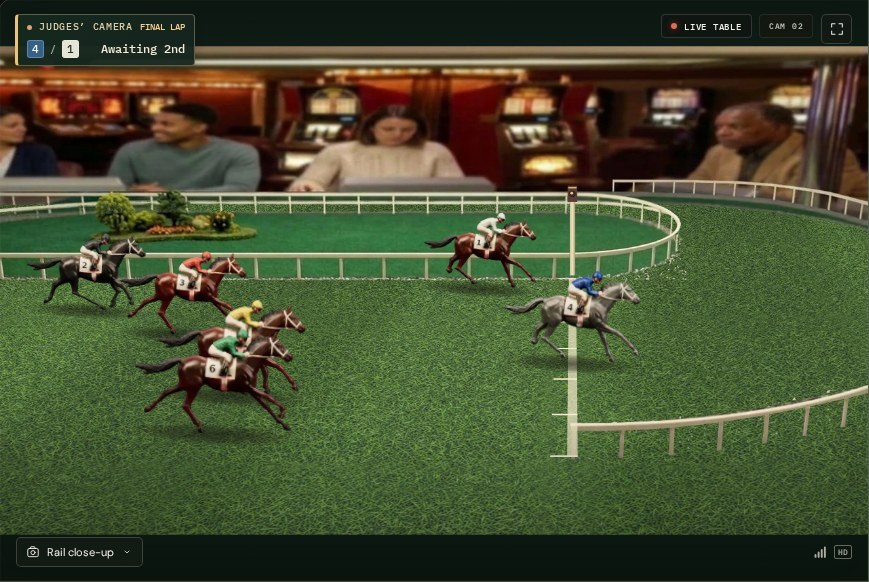

# Royal Ascot · Turf — historische overdracht

Dit is de eerdere Turf-editie. Voor de bredere baan en de twee ingebouwde opnames: [Broad Turf](broad-turf.md).

**Speel lokaal:** open `royal-ascot.html` of start de broncode met `npm start`. Kies *Watch table* en vervolgens *Rail close-up*, *Long-side seat*, *Track map*, *Cabinet orbit*, *Action cam* of *Satellite floor*. Je hebt geen account nodig. De overige spelers in het clubhuis zijn decor; de zes paarden vormen het veld.

## Wat er nu anders is

- **De renbaan, niet alleen het binnenveld, is gras.** Fijne individuele sprieten en maaibanen volgen de bestaande lange baan. Voor stoel en rail zijn ze vooraf in perspectief geprojecteerd; in 3D krijgt dezelfde textuur reliëf. De hekken, baanbreedte, startvakken en finishlijn blijven op hun eigen plaats.
- **Geen voetplaat.** De zes dragers, stangen en bouten zijn uit het huidige paardmodel verwijderd. De hoeven en hun beweging blijven intact. Ook de startstanden, portretten, kaartjes en alle gefotografeerde bewegingen zijn opnieuw gemaakt. Alleen de historische finishfoto’s behouden bewust de originele paarden en ondergrond.
- **Vorm hoort bij een start.** Alle vier de cijfers veranderen bij de volgende deelname van hetzelfde paard. Ze blijven onderling in balans (60–90 per cijfer, totaal 300). Ze sturen de werkelijke krachtverdeling en racecurve. Ze worden niet opnieuw getrokken bij het openen van een kaart, het plaatsen van een ticket of het herladen van de pagina.

Een reproduceerbaar voorbeeld, met proefseed 126:

| Waregem Flyer | FIT | STA | SPR | PAC |
|---|---:|---:|---:|---:|
| Race 021 | 72 | 72 | 90 | 66 |
| Race 022 | 76 | 66 | 89 | 69 |

De officiële uitslag van Race 021 blijft **72 / 72 / 90 / 66** tonen. Bestaande stations houden hun al aangeboden veld en vastgelegde ticketprijzen.

## De twee geluiden

Zet **Sound on** aan. In **How to play → Sound** kun je per vak een opname kiezen. Op kleine schermen staan de vakken soms op afzonderlijke boekpagina’s.

| Vak | Komt overeen met | Wanneer | Lokaal bestand |
|---|---|---|---|
| **Before the start** | Eerste aangewezen opname | Bij het sluiten van de weddenschappen, vóór de start | 0,05–60 s, max. 16 MB |
| **Opening gates** | Tweede aangewezen opname | Eén keer bij het openen van de hekken | 0,05–10 s, max. 4 MB |

De tweede cue stopt de eerste: de deur kan niet onder een lange vooraankondiging verdwijnen. Bij handmatige start is er drie seconden; automatisch is er zeven seconden aanloop en drie seconden stilstand. Import is lokaal, vereist geen microfoon en wist bij opnieuw openen. **De twee aangewezen Drive-opnamen zitten niet in deze editie:** op het moment van bouwen stond Drive uit voor dit gesprek. Totdat ze zijn aangeleverd hoor je de ingebouwde synthese, of je eigen gekozen clips. Schakel Drive in voor dit gesprek of upload beide bestanden om de exacte opnamen te kunnen verwerken.

## Hoe gecontroleerd

- 49 spel-/modelproeven, inclusief een echt opgeslagen station uit `539610d` met twee betaalde tickets: geen wijziging bij laden. Op een nieuwe kaart verandert de vorm, niet het oude ontvangstbewijs.
- Chromium: twee **onderscheidbare lokale proefclips** op de juiste overgangen; dempen, pauze, foutieve import en stil herladen tijdens een race. Deze proefclips zijn niet de Drive-opnamen.
- Seed 126: van laatste aan de bel naar winst voor #4 op **135,268021 s**; marge **0,535948 s**. Nieuwe live- en archiefbeelden hebben op 1280 × 720 identieke RGBA-pixels. Oud v1 en v2 zijn elk apart vergeleken met de eerdere renderer, eveneens pixelgelijk. Dit is een gecontroleerde simulatie, geen echt paardenrennen.
- Hosted schermproef: **9 venster-/lettergrootten, 754 toestanden en 4.301 paneelmetingen**, inclusief twee audiovakken en 40 bewaarde koersen. Een gesimuleerd browserformaat is geen certificering op een fysiek toestel.
- 12.000 gepaarde modelkoersen voor balans en 6.000 velden met wisselende koersvorm: eerste finish in die steekproef **127,43–138,48 s**. Cijfers zijn geen weddenschapsgarantie.

De eerdere [layoutreview](layout-review.html) is de documentatie van Long Course vóór deze wijziging. Voor de afzonderlijke chatbotopdracht: [@architect-sessieboek](../architect/index.html) en [uitvoerbare regisseur](../architect/README.md).
